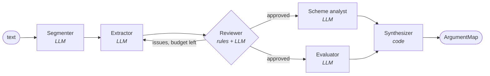
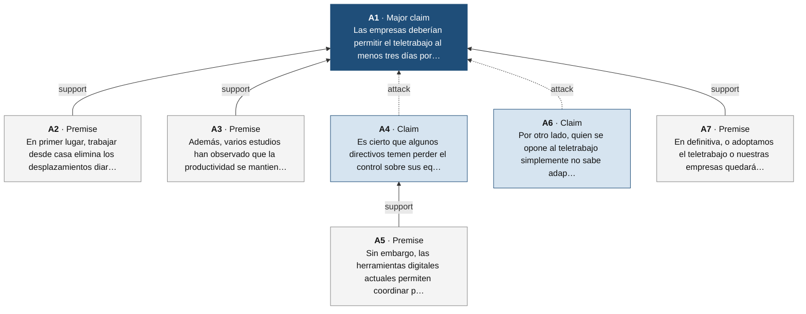

# Argument mining with LangChain + LangGraph

A team of LLM agents that reads a text and returns its **argument structure**: the
central thesis, the claims and premises behind it, how they support or attack each
other, the argumentation scheme of each inference, its implicit premises, and the
fallacies it contains. It runs fully locally on [Ollama](https://ollama.com)
(`llama3.1` 8B by default) and works with any LangChain chat model.

```
$ uv run argmine examples/teletrabajo_es.txt
[  13.4s] segmenter done
[  33.2s] extractor done
[  44.7s] reviewer done
...
[ 147.3s] synthesizer done
```

## Pipeline



| Agent | Output | What it does |
|---|---|---|
| **Segmenter** | `SegmentationOutput` | Splits the text into argumentative discourse units (ADUs) and detects its language. Code assigns ids `A1…An`. |
| **Extractor** | `ExtractionOutput` | Labels each unit `major_claim` / `claim` / `premise` and says which unit it supports or attacks. |
| **Reviewer** | `ReviewOutput` | First runs exact structural checks in Python (unknown ids, missing targets, self-loops, cycles, a major claim that is not the root). Only if those pass does an LLM check the structure against the text. Problems are sent back to the extractor with its previous answer. |
| **Scheme analyst** | `SchemesOutput` | Classifies each argument by Walton scheme (expert opinion, analogy, cause to effect, consequences…), states its implicit premises (enthymemes) and the critical questions the text leaves open. |
| **Evaluator** | `EvaluationOutput` | Checks every unit for fallacies and scores each argument from 1 to 5. |
| **Synthesizer** | `ArgumentMap` | Plain code: assembles the result and exports JSON, Markdown and a Mermaid argument map. |

The scheme analyst and the evaluator run **in parallel** (LangGraph fan-out/fan-in).

## Design decisions

- **Typed contracts between agents.** Every agent is an LCEL chain
  `prompt | llm.with_structured_output(PydanticModel)`, retried on invalid output.
  Ollama enforces the JSON schema, so enums such as roles or fallacy names cannot
  be invented.
- **A schema that makes errors harder.** A first version asked for free-form
  `source -> target` edges, and `llama3.1` 8B kept reversing them (thesis
  "supporting" its own premises). Asking each unit *"what do you support or
  attack?"* turns the output into a tree, as in the Argument Annotated Essays
  corpus, and fixed the direction errors.
- **Cheap checks before expensive ones.** Structural errors are caught by
  deterministic code (`structure.py`) and fed back without spending an LLM call.
- **Reasoning before the label.** In `UnitCheck` the `reasoning` field comes
  before `fallacy`, so the model justifies before committing to a verdict.
- **Bounded self-correction.** The extractor/reviewer loop has a revision budget
  (`--max-revisions`, default 2). Issues still open are reported in the output,
  not hidden.
- **Model-agnostic.** `build_graph(llm)` takes any chat model with structured
  output support. Tests inject a scripted fake model, so the graph logic is
  tested without a model running.
- **Language-aware.** Prompts are in English (small models follow them better),
  but explanations are written in the language detected by the segmenter.

## Quick start

Requirements: Python 3.11+, [uv](https://docs.astral.sh/uv/) and Ollama.

```bash
ollama pull llama3.1
uv sync
uv run argmine examples/teletrabajo_es.txt --out output/teletrabajo_es
```

Outputs in `--out`:

- `report.md`: conclusions, arguments, schemes, scores, fallacies and the map
- `result.json`: the full `ArgumentMap`
- `argument_map.mmd`: Mermaid diagram (support `-->`, attack `-.->`)

Options: `--model`, `--base-url`, `--num-ctx`, `--max-revisions`, and
`--show-graph` to print the LangGraph pipeline itself as Mermaid. Use `-` as
input to read stdin.

### Web app

```bash
uv run argmine-app        # then open http://localhost:8501
```

A Streamlit interface: paste or upload a text (or load an example), pick any
installed Ollama model, and watch each agent finish in real time. Results are
split into tabs: conclusions, an interactive argument map (Graphviz), arguments
with schemes and strength, fallacies and assessment, and downloads (Markdown,
JSON, Mermaid, DOT). The app only listens on `localhost`, sends no usage
statistics, and needs no API keys: everything runs on your machine.

### From Python

```python
from langchain_ollama import ChatOllama
from argmining.graph import build_graph
from argmining.export import to_markdown

app = build_graph(ChatOllama(model="llama3.1", temperature=0, num_ctx=8192))
result = app.invoke({"text": open("examples/school_start_en.txt").read()})["result"]
print([c.text for c in result.conclusions])
print(to_markdown(result))
```

Any other provider works the same way, e.g. `langchain_anthropic.ChatAnthropic`.

### Tracing with LangSmith

Set `LANGSMITH_TRACING=true` and `LANGSMITH_API_KEY`. Each agent appears as a
named run (`segmenter`, `extractor`, …) inside the graph trace.

## Example

Output for [`examples/teletrabajo_es.txt`](examples/teletrabajo_es.txt) with
`llama3.1` 8B (about 2 minutes on a laptop):



Fallacies found: `ad_hominem` in A6 ("whoever opposes remote work just can't adapt")
and `slippery_slope` in A7. Scheme of the main argument: `consequences`, with the
implicit premise *"companies that don't adopt remote work will lose competitiveness"*.

What a human annotator would correct: A5 is a rebuttal, so it should **attack**
A4, not support it. A6 is an ad hominem *for* the thesis, not an attack on it. A7
is better described as a `false_dilemma`. These are the kinds of errors the
quantitative evaluation below is meant to measure.

## Evaluation on the Argument Annotated Essays corpus

`argmine-eval` runs the pipeline over the persuasive essays of
[AAE v2](https://tudatalib.ulb.tu-darmstadt.de/handle/tudatalib/2422)
(Stab & Gurevych, 2017; 402 essays, 80 in the test split) and compares the
output with the expert annotation.

The corpus licence allows research use only and forbids redistribution, so it
is not included. To get it, download `ArgumentAnnotatedEssays-2.0.zip` from the
link above, unzip it into `data/aae2/`, and also unzip the `brat-project-final.zip`
inside it.

```bash
uv run argmine-eval --data data/aae2 --limit 20          # 20 test essays
uv run argmine-eval --data data/aae2 --limit 0           # whole test split
uv run argmine-eval --data data/aae2 --score-only --threshold 1.0
```

Predictions are cached per essay in `output/eval/<model>/predictions/`. A run can
be interrupted and resumed, and it can be re-scored without calling the model.

**Metrics** (micro-averaged, end to end; see `src/argmining/eval/metrics.py`):

- The pipeline returns unit texts, so each one is located in the essay and
  aligned one-to-one with gold components. They match when the character
  overlap is at least 50% of the longer span, the "approximate match" of
  Eger et al. (2017).
- **Component segmentation**: was the component found at all?
- **major_claim / claim / premise** and their **macro F1**: found *and* given
  the right role.
- **Relations**: both endpoints match gold components and the gold annotation
  has that link. It is scored without the type (*untyped*) and with the right
  support/attack type. A gold claim's stance targets "the major claim", so a link
  to any of the essay's major claims counts.

**Known mismatch:** AAE essays usually restate the thesis as a major claim in both
the introduction and the conclusion, while the extractor is told to pick exactly
one. That caps major-claim recall at about 50% by design.

<!-- EVAL_RESULTS -->

## Tests

```bash
uv run pytest                          # graph + validation logic, no model needed
RUN_OLLAMA_TESTS=1 uv run pytest -m ollama   # end-to-end against local Ollama
```

The graph tests cover the happy path, the structural feedback loop (no reviewer
call when the structure is broken), the reviewer feedback loop, the revision
budget, empty input and the exports.

## Limitations and next steps

- An 8B local model gets most of the structure right on short essays, but it still
  confuses support and attack in rebuttals, and its results vary from run to run.
  The LLM reviewer is the weakest agent. It often rejects good structures over
  claim/premise labels, and on reruns the extractor can trade one error for
  another. A stronger model as reviewer (a hosted model through `build_graph`, or
  `llama3.1:70b`) is the obvious upgrade.
- Free-text fields sometimes come back in English for non-English input.
- Use the evaluation to compare models and prompt variants, e.g. a larger
  reviewer, or allowing several major claims.
- Long documents: chunk by paragraph and merge the per-paragraph maps.

## Project layout

```
src/argmining/
  schemas.py    Pydantic contracts (LLM outputs and domain objects)
  prompts.py    one ChatPromptTemplate per agent
  agents.py     graph nodes and shared state
  structure.py  deterministic validation and argument grouping
  graph.py      LangGraph wiring
  export.py     networkx, Mermaid and Markdown exports
  cli.py        `argmine` and `argmine-app` commands
  app.py        Streamlit front end
  eval/         AAE loader, span alignment, F1 metrics, `argmine-eval`
tests/          scripted-LLM tests of the graph, validation and metrics
examples/       sample texts (Spanish and English)
```

> **Note for macOS iCloud Desktop/Documents:** iCloud marks new files inside
> `.venv` as hidden, and Python 3.12+ then ignores the editable-install `.pth`
> file (`ModuleNotFoundError: argmining`). Keep the environment in a folder iCloud
> skips: `UV_PROJECT_ENVIRONMENT=.venv.nosync uv sync && ln -s .venv.nosync .venv`.
